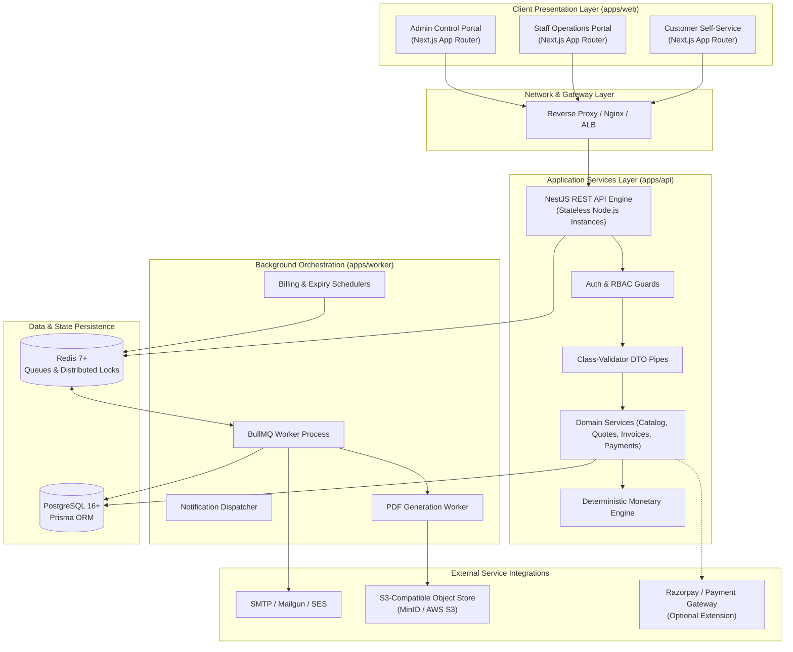
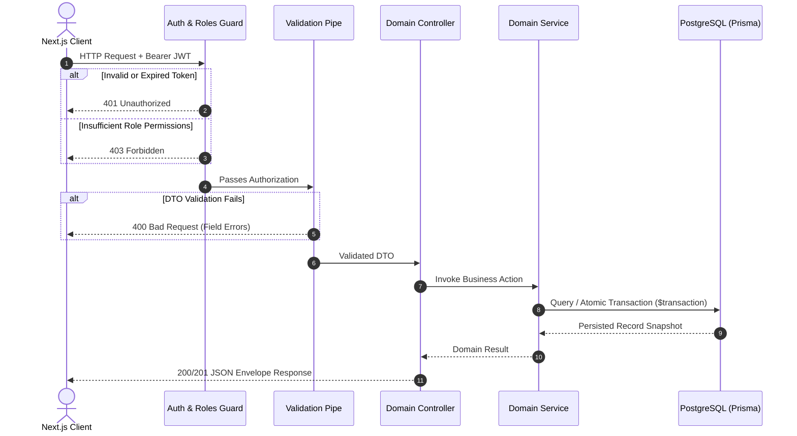
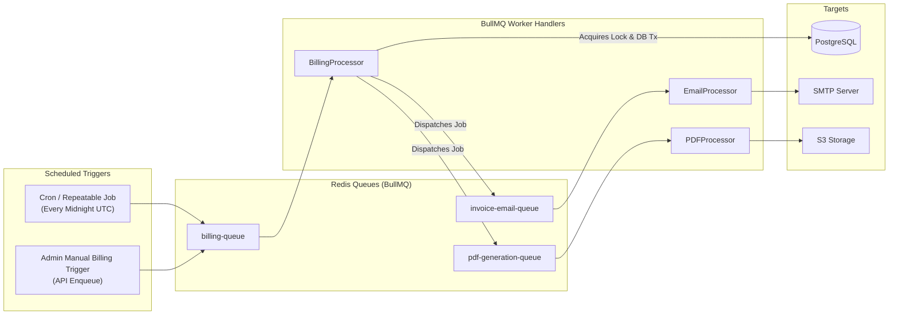

# System Architecture Document

> Comprehensive architectural specification for the **Subscription Management System (SMS)**.

---

## 1. High-Level System Architecture

The Subscription Management System is engineered as a decoupled, multi-tier system organized within a monorepo workspace. It separates client rendering, business API execution, background job orchestration, and persistence layers.



---

## 2. Frontend Architecture (`apps/web`)

The frontend application is built with **Next.js (App Router)** and **Tailwind CSS**, designed for sub-2-second responses, visual appeal, and strict role isolation.

### 2.1 Route & Layout Hierarchy
```text
apps/web/src/
├── app/
│   ├── (auth)/                  # Public auth layout
│   │   ├── login/page.tsx
│   │   ├── register/page.tsx
│   │   ├── forgot-password/page.tsx
│   │   └── reset-password/page.tsx
│   ├── (dashboard)/             # Authenticated shell layout (Sidebar, Navbar, Theme)
│   │   ├── admin/               # Admin role only
│   │   │   ├── products/
│   │   │   ├── plans/
│   │   │   ├── taxes/
│   │   │   ├── discounts/
│   │   │   ├── staff/
│   │   │   └── reports/
│   │   ├── staff/               # Staff & Admin access
│   │   │   ├── customers/
│   │   │   ├── quotations/
│   │   │   ├── subscriptions/
│   │   │   ├── invoices/
│   │   │   └── payments/
│   │   └── portal/              # Customer self-service portal
│   │       ├── overview/
│   │       ├── subscriptions/
│   │       ├── invoices/
│   │       └── profile/
│   ├── layout.tsx
│   └── page.tsx                 # Landing / Status redirector
├── components/
│   ├── ui/                      # Atomic design primitives (Button, Modal, Table, Badge, Card)
│   ├── forms/                   # Validated forms (React Hook Form + Zod)
│   └── layouts/                 # Shell navigation, headers, breadcrumbs
├── features/                    # Domain-encapsulated UI modules
│   ├── auth/
│   ├── catalog/
│   ├── subscriptions/
│   ├── billing/
│   └── analytics/
├── lib/                         # Client API client, token store, formatters
└── styles/                      # Tailwind design system tokens
```

### 2.2 Client State & Data Fetching
- **Server Components:** Utilized by default for dashboard summaries and initial list hydration to eliminate client-side waterfall latency.
- **Client Components:** Reserved for interactive modals, data tables with live client filtering, quotation builders, and form inputs.
- **API Communication:** Type-safe wrapper using `fetch` with automatic bearer token attachment, refresh token rotation, and standardized error parsing.

---

## 3. Backend Modular Architecture (`apps/api`)

The backend is built with **NestJS**, adhering to clean domain-driven module boundaries. Each domain is isolated within its own module encapsulating controllers, services, DTOs, and repositories.

```mermaid
graph TD
    AppModule["AppModule (Core)"]
    
    %% Core Infrastructure
    AppModule --> ConfigModule["ConfigModule (Env Validation)"]
    AppModule --> PrismaModule["PrismaModule (Database Access)"]
    AppModule --> RedisModule["RedisModule (Queue & Lock Client)"]
    AppModule --> HealthModule["HealthModule (/api/health)"]

    %% Domain Modules
    AppModule --> AuthModule["AuthModule (JWT & Password Policy)"]
    AppModule --> UsersModule["UsersModule (Staff & Permissions)"]
    AppModule --> CustomersModule["CustomersModule (Customer Profiles)"]
    AppModule --> ProductsModule["ProductsModule (Catalog & Variants)"]
    AppModule --> PlansModule["PlansModule (Billing Frequencies & Rules)"]
    AppModule --> PricingModule["PricingModule (Monetary & Tax Calculations)"]
    AppModule --> QuotationsModule["QuotationsModule (Templates & Conversion)"]
    AppModule --> SubscriptionsModule["SubscriptionsModule (Lifecycle & Transitions)"]
    AppModule --> BillingModule["BillingModule (Due Subscriptions & Invoicing)"]
    AppModule --> InvoicesModule["InvoicesModule (PDF, Numbering, Cancellation)"]
    AppModule --> PaymentsModule["PaymentsModule (Balance Reconciliation)"]
    AppModule --> ReportsModule["ReportsModule (Financial Analytics)"]
    AppModule --> AuditModule["AuditModule (Audit Logging)"]

    QuotationsModule --> PricingModule
    SubscriptionsModule --> PricingModule
    BillingModule --> PricingModule
    BillingModule --> InvoicesModule
    PaymentsModule --> InvoicesModule
```



### 3.1 Cross-Cutting Concerns
- **Global Validation Pipe:** Automatically validates and strips untyped fields (`whitelist: true`, `forbidNonWhitelisted: true`, `transform: true`).
- **Global Exception Filter:** Intercepts all exceptions, transforming them into a predictable JSON envelope:
  ```json
  {
    "success": false,
    "statusCode": 400,
    "error": "Bad Request",
    "message": "Validation failed",
    "details": ["email must be an email"],
    "timestamp": "2026-10-31T11:45:00.000Z",
    "path": "/api/v1/auth/register"
  }
  ```
- **Logging Interceptor:** Measures and logs execution duration for all HTTP requests to safeguard the sub-2-second performance SLA.

---

## 4. API Communication Flow

Every inbound HTTP request traverses structured security and validation layers before hitting business domain logic:



---

## 5. Background Worker Architecture (`apps/worker`)

Background processing is decoupled into a dedicated Node.js worker process utilizing **Redis** and **BullMQ**. This ensures long-running tasks (recurring billing cycles, PDF rendering, email notifications) do not block or degrade API response times.



### 5.1 BullMQ Queues
1. `billing-queue`: Processes due subscriptions and generates invoices. Supports concurrency limits and automatic exponential backoff retries.
2. `pdf-generation-queue`: Offloads server-side PDF generation.
3. `notification-queue`: Dispatches transactional emails (password reset, invoice attachments, renewal notices).

---

## 6. Database Interaction Flow & Transaction Management

Financial mutations demand absolute consistency and isolation. The system enforces:

1. **Prisma Interactive Transactions (`prisma.$transaction`):**
   Used for:
   - Quotation conversion $\to$ Subscription creation.
   - Due Subscription $\to$ Billing Period lock $\to$ Invoice creation $\to$ Line snapshots.
   - Payment recording $\to$ Invoice balance update $\to$ Status transition.
2. **Distributed Redis Locks (`ioredis` / `redlock`):**
   - Applied during billing execution on `subscription:{id}` to guarantee that even if multiple worker containers execute simultaneously, exactly one worker processes a specific subscription.
3. **Database Unique Constraints:**
   - Physical table constraint on `billing_periods(subscription_id, period_start, period_end)` serves as the ultimate fallback defense against duplicate invoicing.

---

## 7. Architecture Review & Risk Assessment

### 7.1 Scalability
- **Horizontal Scaling:** The API server and worker instances are completely stateless. Scaling horizontally simply requires adding instances behind the load balancer or starting additional BullMQ worker processes.
- **Read Scalability:** Read queries utilize database indexes on `customer_id`, `status`, `next_billing_date`, and composite indexes for date ranges.

### 7.2 Financial Data Integrity
- **Integer Minor Units:** All monetary values are strictly stored as 64-bit integers (`BigInt` or `Int` representing paise/cents). Floating-point math is banned.
- **Snapshot Immutability:** Historical invoice items snapshot unit prices, variant add-ons, applied tax percentages, and discount values directly on the row. Catalog updates never cascade backwards.

### 7.3 Recurring Billing Reliability
- **Idempotency by Design:** Each billing period is uniquely identifiable. Worker crashes during job execution will retry cleanly because the database transaction will either commit atomically or roll back completely.

### 7.4 Security Posture
- **OWASP Compliance:** Server-side input validation, parameter sanitization, parameterized queries via Prisma, rate limiting on sensitive endpoints, secure HTTP headers via Helmet, and strict role guards.
- **Data Isolation:** Customer queries are strictly filtered by authenticated `user.customer_id` directly in the database query clause.

### 7.5 Architecture Risks & Mitigations

| Risk | Impact | Architectural Mitigation |
|---|---|---|
| Concurrent billing runs cause double billing | Severe (Financial loss & trust) | Multi-tier defense: Distributed Redis lock + PostgreSQL unique constraint on `(subscription_id, period_start, period_end)`. |
| Month-end billing shifts (Feb 28 vs 31st) | Medium (Skewed billing cycles) | Anchor Day clamping strategy preserving original anchor day across full-length months. |
| Third-party outage (SMTP / S3 / Gateway) | Low-Medium (Delayed alerts/PDFs) | Decoupled BullMQ queues with exponential backoff retries; primary invoice record creation succeeds independently of notification dispatch. |
| Slow dashboard aggregations under 10k+ rows | High (Breaches < 2s SLA) | Indexed composite queries, database aggregate queries (`_sum`, `_count`), server-side pagination (`take`/`skip`), and read caching in Redis for top-level stats. |
| Floating point arithmetic corruption | Severe (Accounting discrepancies) | Universal integer minor unit standard throughout API, database, and pricing calculations. |
