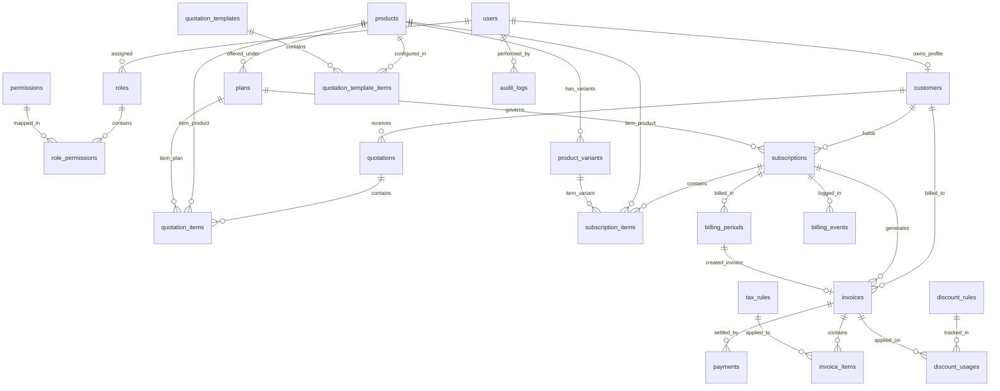

# Database Design Document

> PostgreSQL relational database design for the **Subscription Management System (SMS)**.

---

## 1. Database Design Principles

1. **Relational Integrity:** Foreign keys enforced on all child-parent relations with appropriate cascade rules (`RESTRICT` on financial records, `CASCADE` on transient draft line items).
2. **Integer Minor Units for Currency:** All monetary values (prices, totals, discounts, taxes, balances, payments) are stored as integers representing minor units (e.g., paise in INR: ₹100.50 is stored as `10050`). No floating-point data types.
3. **Snapshot Immutability:** Historical financial records (`invoice_items`, `quotation_items`, `subscription_items`) store frozen copies of item descriptions, unit prices, variant add-ons, tax percentages, and discount amounts.
4. **Idempotency Safeguards:** Unique compound indexes on billing periods `(subscription_id, period_start, period_end)` prevent duplicate recurring billing.
5. **UTC Time Standard:** All timestamp columns (`created_at`, `updated_at`, `start_date`, `expiry_date`, `next_billing_date`, `due_date`) are stored with timezones in UTC (`timestamptz`).
6. **Query Optimization:** Targeted composite and B-Tree indexes for frequently filtered columns (`customer_id`, `status`, `next_billing_date`, `due_date`).

---

## 2. Entity-Relationship (ER) Diagram

---

## 3. Detailed Entity Specifications

### 3.1 Authentication & RBAC

#### `users`
Represents login identities across Admin, Staff, and Customer users.
- `id` (UUID, PK, default: `gen_random_uuid()`)
- `email` (VARCHAR(255), UNIQUE, NOT NULL, INDEX)
- `password_hash` (VARCHAR(255), NOT NULL)
- `first_name` (VARCHAR(100), NOT NULL)
- `last_name` (VARCHAR(100), NOT NULL)
- `phone` (VARCHAR(20), NULL)
- `role_id` (UUID, FK `roles.id`, NOT NULL)
- `is_active` (BOOLEAN, default: `true`, NOT NULL)
- `last_login_at` (TIMESTAMPTZ, NULL)
- `reset_token` (VARCHAR(255), NULL)
- `reset_token_expires_at` (TIMESTAMPTZ, NULL)
- `created_at` (TIMESTAMPTZ, default: `NOW()`, NOT NULL)
- `updated_at` (TIMESTAMPTZ, default: `NOW()`, NOT NULL)

#### `roles`
System roles (`ADMIN`, `STAFF`, `CUSTOMER`).
- `id` (UUID, PK)
- `name` (VARCHAR(50), UNIQUE, NOT NULL)
- `description` (TEXT, NULL)
- `created_at` (TIMESTAMPTZ, default: `NOW()`, NOT NULL)

#### `permissions`
Granular authorization capabilities.
- `id` (UUID, PK)
- `code` (VARCHAR(100), UNIQUE, NOT NULL) — e.g., `quotation:create`, `payment:record`
- `description` (TEXT, NULL)

#### `role_permissions`
Junction table for role capabilities.
- `role_id` (UUID, FK `roles.id`, PK)
- `permission_id` (UUID, FK `permissions.id`, PK)

---

### 3.2 Customer Profiles

#### `customers`
Business or individual profile associated with a customer account.
- `id` (UUID, PK)
- `user_id` (UUID, FK `users.id`, UNIQUE, NULL, INDEX) — NULL if customer profile is created prior to user signup
- `customer_number` (VARCHAR(50), UNIQUE, NOT NULL, INDEX) — e.g., `CUST-2026-0001`
- `company_name` (VARCHAR(200), NULL)
- `contact_name` (VARCHAR(200), NOT NULL)
- `email` (VARCHAR(255), NOT NULL, INDEX)
- `phone` (VARCHAR(50), NULL)
- `billing_address_line1` (TEXT, NOT NULL)
- `billing_address_line2` (TEXT, NULL)
- `city` (VARCHAR(100), NOT NULL)
- `state` (VARCHAR(100), NOT NULL)
- `postal_code` (VARCHAR(20), NOT NULL)
- `country` (VARCHAR(100), NOT NULL, default: `'India'`)
- `tax_id` (VARCHAR(50), NULL) — e.g. GSTIN
- `is_active` (BOOLEAN, default: `true`, NOT NULL)
- `created_at` (TIMESTAMPTZ, default: `NOW()`, NOT NULL)
- `updated_at` (TIMESTAMPTZ, default: `NOW()`, NOT NULL)

---

### 3.3 Catalog: Products, Variants & Plans

#### `products`
Base products offered in the catalog.
- `id` (UUID, PK)
- `name` (VARCHAR(200), NOT NULL, INDEX)
- `sku` (VARCHAR(100), UNIQUE, NOT NULL)
- `product_type` (VARCHAR(50), NOT NULL) — e.g., `SERVICE`, `SOFTWARE`, `HARDWARE`
- `sales_price` (INTEGER, NOT NULL) — base sales price in minor units (paise)
- `cost_price` (INTEGER, NOT NULL) — cost price in minor units (paise)
- `description` (TEXT, NULL)
- `is_active` (BOOLEAN, default: `true`, NOT NULL, INDEX)
- `created_at` (TIMESTAMPTZ, default: `NOW()`, NOT NULL)
- `updated_at` (TIMESTAMPTZ, default: `NOW()`, NOT NULL)

#### `product_variants`
Specific variations of a product adding incremental price.
- `id` (UUID, PK)
- `product_id` (UUID, FK `products.id`, NOT NULL, INDEX)
- `name` (VARCHAR(150), NOT NULL) — e.g., "Odoo Edition", "Enterprise Support"
- `additional_price` (INTEGER, default: `0`, NOT NULL) — price addition in minor units
- `sku_suffix` (VARCHAR(50), NULL)
- `is_active` (BOOLEAN, default: `true`, NOT NULL)
- `created_at` (TIMESTAMPTZ, default: `NOW()`, NOT NULL)
- `updated_at` (TIMESTAMPTZ, default: `NOW()`, NOT NULL)

#### `plans`
Subscription tier definitions governing recurring billing rules.
- `id` (UUID, PK)
- `product_id` (UUID, FK `products.id`, NOT NULL, INDEX)
- `name` (VARCHAR(150), NOT NULL)
- `code` (VARCHAR(50), UNIQUE, NOT NULL)
- `billing_frequency` (VARCHAR(20), NOT NULL) — `DAILY`, `WEEKLY`, `MONTHLY`, `YEARLY`
- `price` (INTEGER, NOT NULL) — plan unit price in minor units
- `minimum_quantity` (INTEGER, default: `1`, NOT NULL)
- `start_date` (TIMESTAMPTZ, NULL)
- `end_date` (TIMESTAMPTZ, NULL)
- `is_auto_close` (BOOLEAN, default: `true`, NOT NULL)
- `is_early_close_allowed` (BOOLEAN, default: `false`, NOT NULL)
- `is_pause_allowed` (BOOLEAN, default: `true`, NOT NULL)
- `is_renewal_allowed` (BOOLEAN, default: `true`, NOT NULL)
- `is_active` (BOOLEAN, default: `true`, NOT NULL, INDEX)
- `created_at` (TIMESTAMPTZ, default: `NOW()`, NOT NULL)
- `updated_at` (TIMESTAMPTZ, default: `NOW()`, NOT NULL)

---

### 3.4 Taxes & Discounts

#### `tax_rules`
Configurable tax definitions.
- `id` (UUID, PK)
- `name` (VARCHAR(100), NOT NULL) — e.g., "GST 18%", "VAT 5%"
- `rate_basis_points` (INTEGER, NOT NULL) — e.g., 1800 for 18.00%
- `description` (TEXT, NULL)
- `is_active` (BOOLEAN, default: `true`, NOT NULL)
- `created_at` (TIMESTAMPTZ, default: `NOW()`, NOT NULL)

#### `discount_rules`
Promotional and volume discount configurations.
- `id` (UUID, PK)
- `code` (VARCHAR(50), UNIQUE, NOT NULL, INDEX)
- `description` (TEXT, NULL)
- `discount_type` (VARCHAR(20), NOT NULL) — `PERCENTAGE`, `FIXED_AMOUNT`
- `value` (INTEGER, NOT NULL) — basis points for percentage (e.g., 1000 = 10%) or minor units for fixed
- `min_purchase_amount` (INTEGER, default: `0`, NOT NULL)
- `min_quantity` (INTEGER, default: `1`, NOT NULL)
- `max_uses` (INTEGER, NULL) — total allowed system uses
- `current_uses` (INTEGER, default: `0`, NOT NULL)
- `start_date` (TIMESTAMPTZ, NULL)
- `end_date` (TIMESTAMPTZ, NULL)
- `product_id` (UUID, FK `products.id`, NULL) — NULL if applicable system-wide
- `is_active` (BOOLEAN, default: `true`, NOT NULL)
- `created_at` (TIMESTAMPTZ, default: `NOW()`, NOT NULL)

#### `discount_usages`
Tracks actual discount redemptions per invoice.
- `id` (UUID, PK)
- `discount_rule_id` (UUID, FK `discount_rules.id`, NOT NULL, INDEX)
- `invoice_id` (UUID, FK `invoices.id`, NOT NULL, INDEX)
- `applied_amount` (INTEGER, NOT NULL)
- `used_at` (TIMESTAMPTZ, default: `NOW()`, NOT NULL)

---

### 3.5 Quotations

#### `quotation_templates`
Reusable quotation templates for sales staff.
- `id` (UUID, PK)
- `name` (VARCHAR(150), NOT NULL)
- `description` (TEXT, NULL)
- `created_at` (TIMESTAMPTZ, default: `NOW()`, NOT NULL)

#### `quotation_template_items`
Pre-configured line items in a template.
- `id` (UUID, PK)
- `template_id` (UUID, FK `quotation_templates.id`, CASCADE, NOT NULL)
- `product_id` (UUID, FK `products.id`, NOT NULL)
- `plan_id` (UUID, FK `plans.id`, NULL)
- `default_quantity` (INTEGER, default: `1`, NOT NULL)

#### `quotations`
Customer-addressed commercial offers.
- `id` (UUID, PK)
- `quotation_number` (VARCHAR(50), UNIQUE, NOT NULL, INDEX) — e.g., `QT-2026-0001`
- `customer_id` (UUID, FK `customers.id`, NOT NULL, INDEX)
- `status` (VARCHAR(30), NOT NULL, INDEX) — `DRAFT`, `SENT`, `ACCEPTED`, `EXPIRED`, `CONVERTED`
- `valid_until` (TIMESTAMPTZ, NOT NULL)
- `subtotal` (INTEGER, NOT NULL)
- `discount_amount` (INTEGER, default: `0`, NOT NULL)
- `tax_amount` (INTEGER, default: `0`, NOT NULL)
- `total_amount` (INTEGER, NOT NULL)
- `notes` (TEXT, NULL)
- `created_by_user_id` (UUID, FK `users.id`, NOT NULL)
- `created_at` (TIMESTAMPTZ, default: `NOW()`, NOT NULL)
- `updated_at` (TIMESTAMPTZ, default: `NOW()`, NOT NULL)

#### `quotation_items`
Snapshot line items in a quotation.
- `id` (UUID, PK)
- `quotation_id` (UUID, FK `quotations.id`, CASCADE, NOT NULL, INDEX)
- `product_id` (UUID, FK `products.id`, NOT NULL)
- `plan_id` (UUID, FK `plans.id`, NULL)
- `item_description` (VARCHAR(255), NOT NULL)
- `quantity` (INTEGER, NOT NULL)
- `unit_price` (INTEGER, NOT NULL)
- `tax_rate_basis_points` (INTEGER, default: `0`, NOT NULL)
- `line_total` (INTEGER, NOT NULL)

---

### 3.6 Subscriptions & Billing

#### `subscriptions`
Customer subscription contracts.
- `id` (UUID, PK)
- `subscription_number` (VARCHAR(50), UNIQUE, NOT NULL, INDEX) — e.g., `SUB-2026-0001`
- `customer_id` (UUID, FK `customers.id`, NOT NULL, INDEX)
- `plan_id` (UUID, FK `plans.id`, NOT NULL, INDEX)
- `quotation_id` (UUID, FK `quotations.id`, NULL)
- `status` (VARCHAR(30), NOT NULL, INDEX) — `DRAFT`, `QUOTATION`, `CONFIRMED`, `ACTIVE`, `PAUSED`, `CLOSED`
- `start_date` (TIMESTAMPTZ, NOT NULL)
- `expiry_date` (TIMESTAMPTZ, NOT NULL, INDEX)
- `anchor_billing_day` (INTEGER, NOT NULL) — 1 to 31
- `next_billing_date` (TIMESTAMPTZ, NULL, INDEX)
- `payment_terms` (VARCHAR(100), default: `'NET_15'`, NOT NULL)
- `subtotal` (INTEGER, NOT NULL)
- `tax_amount` (INTEGER, default: `0`, NOT NULL)
- `total_amount` (INTEGER, NOT NULL)
- `created_at` (TIMESTAMPTZ, default: `NOW()`, NOT NULL)
- `updated_at` (TIMESTAMPTZ, default: `NOW()`, NOT NULL)

#### `subscription_items`
Configured lines of a subscription.
- `id` (UUID, PK)
- `subscription_id` (UUID, FK `subscriptions.id`, CASCADE, NOT NULL, INDEX)
- `product_id` (UUID, FK `products.id`, NOT NULL)
- `product_variant_id` (UUID, FK `product_variants.id`, NULL)
- `quantity` (INTEGER, NOT NULL)
- `unit_price` (INTEGER, NOT NULL) — snapshot unit price
- `tax_rate_basis_points` (INTEGER, default: `0`, NOT NULL)
- `line_total` (INTEGER, NOT NULL)

#### `billing_periods`
Enforces idempotency for recurring billing cycles.
- `id` (UUID, PK)
- `subscription_id` (UUID, FK `subscriptions.id`, NOT NULL, INDEX)
- `period_start` (TIMESTAMPTZ, NOT NULL)
- `period_end` (TIMESTAMPTZ, NOT NULL)
- `invoice_id` (UUID, FK `invoices.id`, NULL, INDEX)
- `status` (VARCHAR(30), default: `'BILLED'`, NOT NULL) — `BILLED`, `SKIPPED`, `CANCELLED`
- `created_at` (TIMESTAMPTZ, default: `NOW()`, NOT NULL)
- **Constraint:** `UNIQUE (subscription_id, period_start, period_end)`

#### `billing_events`
Audit history of scheduled billing attempts.
- `id` (UUID, PK)
- `subscription_id` (UUID, FK `subscriptions.id`, NOT NULL, INDEX)
- `event_type` (VARCHAR(50), NOT NULL) — `ATTEMPT`, `SUCCESS`, `FAILURE`, `SKIPPED`
- `details` (JSONB, NOT NULL)
- `created_at` (TIMESTAMPTZ, default: `NOW()`, NOT NULL)

---

### 3.7 Invoices & Payments

#### `invoices`
Issued billing invoices.
- `id` (UUID, PK)
- `invoice_number` (VARCHAR(50), UNIQUE, NOT NULL, INDEX) — e.g., `INV-2026-0001`
- `customer_id` (UUID, FK `customers.id`, NOT NULL, INDEX)
- `subscription_id` (UUID, FK `subscriptions.id`, NULL, INDEX)
- `status` (VARCHAR(30), NOT NULL, INDEX) — `DRAFT`, `CONFIRMED`, `CANCELLED`
- `payment_status` (VARCHAR(30), NOT NULL, INDEX) — `UNPAID`, `PARTIALLY_PAID`, `PAID`, `OVERDUE`
- `invoice_date` (TIMESTAMPTZ, NOT NULL, INDEX)
- `due_date` (TIMESTAMPTZ, NOT NULL, INDEX)
- `subtotal` (INTEGER, NOT NULL)
- `discount_amount` (INTEGER, default: `0`, NOT NULL)
- `tax_amount` (INTEGER, default: `0`, NOT NULL)
- `total_amount` (INTEGER, NOT NULL)
- `paid_amount` (INTEGER, default: `0`, NOT NULL)
- `outstanding_balance` (INTEGER, NOT NULL, INDEX)
- `customer_name_snapshot` (VARCHAR(200), NOT NULL)
- `billing_address_snapshot` (JSONB, NOT NULL)
- `pdf_url` (TEXT, NULL)
- `notes` (TEXT, NULL)
- `created_at` (TIMESTAMPTZ, default: `NOW()`, NOT NULL)
- `updated_at` (TIMESTAMPTZ, default: `NOW()`, NOT NULL)

#### `invoice_items`
Frozen line item snapshots on an invoice.
- `id` (UUID, PK)
- `invoice_id` (UUID, FK `invoices.id`, CASCADE, NOT NULL, INDEX)
- `product_id` (UUID, FK `products.id`, NULL)
- `product_variant_id` (UUID, FK `product_variants.id`, NULL)
- `item_description` (VARCHAR(255), NOT NULL)
- `quantity` (INTEGER, NOT NULL)
- `unit_price` (INTEGER, NOT NULL)
- `discount_amount` (INTEGER, default: `0`, NOT NULL)
- `tax_rate_basis_points` (INTEGER, default: `0`, NOT NULL)
- `tax_amount` (INTEGER, default: `0`, NOT NULL)
- `line_total` (INTEGER, NOT NULL)

#### `payments`
Financial payment records settling invoice balances.
- `id` (UUID, PK)
- `payment_number` (VARCHAR(50), UNIQUE, NOT NULL, INDEX) — e.g., `PAY-2026-0001`
- `invoice_id` (UUID, FK `invoices.id`, NOT NULL, INDEX)
- `amount` (INTEGER, NOT NULL) — minor units
- `payment_method` (VARCHAR(50), NOT NULL) — `CASH`, `BANK_TRANSFER`, `CHEQUE`, `CREDIT_CARD_MANUAL`, `ONLINE`
- `payment_date` (TIMESTAMPTZ, NOT NULL, INDEX)
- `reference_note` (TEXT, NULL)
- `gateway_provider` (VARCHAR(50), NULL)
- `gateway_transaction_id` (VARCHAR(150), NULL)
- `recorded_by_user_id` (UUID, FK `users.id`, NULL)
- `created_at` (TIMESTAMPTZ, default: `NOW()`, NOT NULL)

---

### 3.8 Auditing

#### `audit_logs`
Immutable compliance and security trail for mutations.
- `id` (UUID, PK)
- `user_id` (UUID, FK `users.id`, NULL)
- `entity_type` (VARCHAR(50), NOT NULL, INDEX) — e.g., `SUBSCRIPTION`, `INVOICE`, `PAYMENT`
- `entity_id` (UUID, NOT NULL, INDEX)
- `action` (VARCHAR(50), NOT NULL) — `CREATE`, `UPDATE`, `CANCEL`, `PAUSE`, `RESUME`
- `diff` (JSONB, NULL) — before/after payload snapshot
- `ip_address` (VARCHAR(45), NULL)
- `created_at` (TIMESTAMPTZ, default: `NOW()`, NOT NULL, INDEX)
